# Experimentación con JMeter · ¿Qué pasaría si...?

**Tiquetmania · Pruebas de carga, estrés y concurrencia en local**

> El documento de entrega (Word, con todas las capturas) está en [`entrega/Experimentacion_JMeter_Tiquetmania.docx`](entrega/Experimentacion_JMeter_Tiquetmania.docx). Este archivo tiene el mismo contenido en Markdown.

Este documento responde las 10 preguntas de la guía «¿Qué pasaría si...?». Cada pregunta tiene el escenario que diseñé, capturas del escenario configurado en JMeter, los resultados del reporte HTML y del monitoreo de CPU y memoria, mi respuesta y lo que no pude medir o lo que cambió el resultado.

Plan de experimentación: pruebas/experimentacion/experimentacion.jmx (independiente del plan del pipeline). Es una plantilla con propiedades ${__P(...)}; para cada escenario el script run_experimentos.py genera escenarios/<ID>.jmx con los valores concretos. Ese es el archivo que se ejecuta y el que aparece en las capturas, así que cada ejecución cambia una sola variable respecto de la otra.

## Entorno y método

| Aspecto | Detalle |
|---|---|
| Equipo | AMD Ryzen 7 4800H (8 núcleos / 16 hilos), 15,4 GB de RAM, Windows 11 |
| Software | Apache JMeter 5.6.3 con Java 17; API ticketmania_simple.py en Python 3.13 (127.0.0.1:8080) |
| Plugins | jpgc Standard Set (Transactions per Second), jpgc PerfMon y jpgc Custom Thread Groups (Ultimate Thread Group) |
| Flujo por usuario | GET /api/tarifas → POST /api/seleccion (JSON Extractor num_reserva + JSON Assertion del total) → POST /api/pago (JSON Assertion estado = APROBADO y total) |
| Datos | datos.csv con 24 combinaciones (4 tarifas × cantidades 1 a 6) y la columna total_esperado = precio × cantidad |
| Temporizador base | Temporizador Aleatorio Uniforme: 500 ms + 0–1000 ms (pausas de 0,5 a 1,5 s) |
| Ejecución | Modo no-GUI: jmeter -n -t escenarios/<ID>.jmx -l resultados.jtl -e -o reporte. Antes de cada escenario se reinicia la API y se espera a que se liberen las conexiones TCP del escenario anterior. |
| Hardware | PerfMon + ServerAgent 2.2.1 no funcionó: la librería SIGAR se cae con EXCEPTION_ACCESS_VIOLATION en Windows 11. Lo reemplacé con un monitor en Python (psutil) que toma 1 muestra por segundo del CPU y la memoria del equipo, de la API y de JMeter (recursos.csv de cada escenario). |

## Limitaciones generales y qué cambió el resultado

- La API y JMeter comparten el mismo computador. Como recomienda la guía, en una prueba real la API debería correr sola en un equipo dedicado: aquí el resultado mide a los dos juntos.
- PerfMon no estuvo disponible (SIGAR falla en Windows 11); las métricas de hardware vienen de psutil, por proceso, con 1 s de resolución.
- Cada escenario se ejecutó una vez. Las diferencias de pocas décimas de milisegundo están dentro del ruido.
- La API responde en HTTP/1.0: cada petición abre una conexión TCP nueva. En Windows hay 16 384 puertos dinámicos y cada conexión cerrada queda un tiempo en TIME_WAIT, así que con cargas altas y sostenidas se agotan los puertos del lado de JMeter (java.net.BindException). Es un límite del equipo generador, no de la API.
- Qué cambió el resultado: la primera ejecución de E05a dio 0,15 % de errores (BindException) porque empezó con miles de conexiones del escenario anterior todavía en TIME_WAIT. Agregué al script una espera hasta que queden menos de 500 conexiones en TIME_WAIT, repetí E05a y E10, y E05a dio 0 % de errores.

## Ejecución local del Ejercicio 1

Antes de subir `pruebas/jmeter/Ticketmania.jmx` (200 hilos, subida de 300 s, bucle 1, `datos.csv` con ruta relativa) lo ejecuté en local en modo no-GUI: 600 muestras, media de 2,65 ms, p95 de 4 ms, máx. de 35 ms y 0 % de errores en 5 min 02 s (reporte en [`resultados/EJ1-local/reporte/`](resultados/EJ1-local/reporte/index.html)). El paso del pipeline que revisa el `.jtl` terminó con código 0, y con un `.jtl` alterado con una petición fallida terminó con 1. En GitHub Actions el job quedó en verde con las mismas 600 muestras sin errores y publicó el artefacto `reporte-rendimiento`.

---

## P1 · CARGA: ¿Qué pasaría si subo de 20 a 500 usuarios? ¿Cambia el throughput, el tiempo de respuesta o ambos?

**Qué cambia:** Número de hilos (20 → 500). Todo lo demás igual.  
**Métrica elegida:** Throughput (Rendimiento), Media, p95, Máx y % Error.

| Escenario | E01a | E01b |
|---|---|---|
| Tipo de hilo | Grupo de Hilos estándar | Grupo de Hilos estándar |
| Hilos | 20 | 500 |
| Subida (ramp-up) | 10 s | 10 s |
| Duración | 60 s (bucle infinito con planificador) | 60 s (bucle infinito con planificador) |
| Temporizador | Temporizador Aleatorio Uniforme: 500 ms + 0–1000 ms (pausas de 0,5 a 1,5 s) | Temporizador Aleatorio Uniforme: 500 ms + 0–1000 ms (pausas de 0,5 a 1,5 s) |

**Escenario configurado en JMeter:**


**Resultados observados:**

| Métrica | 20 usuarios (E01a) | 500 usuarios (E01b) |
|---|---|---|
| Muestras | 1 100 | 27 243 |
| Throughput | 18,8 pet/s | 458,5 pet/s |
| Media | 2,39 ms | 3,68 ms |
| p95 | 3 ms | 8 ms |
| Máx | 52 ms | 54 ms |
| % Error | 0 % | 1,58 % |
| CPU del equipo (media / máx.) | 12 % / 25 % | 36 % / 72 % |


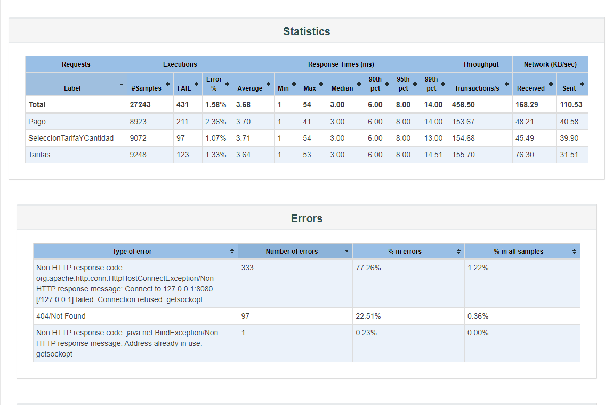

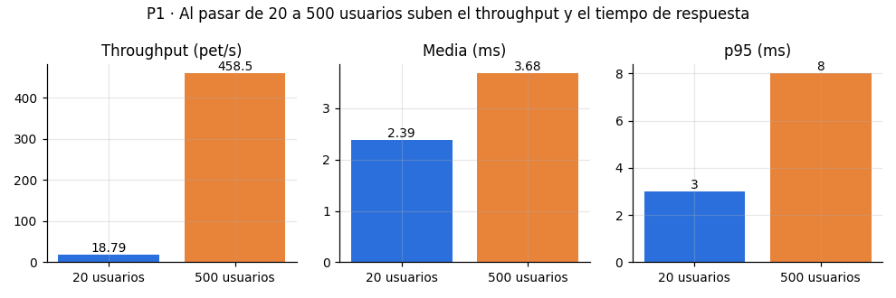

**Respuesta:**

Cambian ambos. El throughput se multiplicó por 24,4 con 25 veces más usuarios (18,8 → 458,5 pet/s), casi proporcional, porque cada usuario hace en promedio ≈ 0,93 peticiones por segundo por el temporizador. Pero el tiempo de respuesta también subió: la media un 54 % (2,39 → 3,68 ms) y el p95 casi se triplicó (3 → 8 ms).

Con 500 usuarios aparecieron errores por primera vez (1,58 %). Fueron 333 conexiones rechazadas (HttpHostConnectException) porque la cola de conexiones de la API se llenó en algunos momentos, y 97 respuestas 404 en Pago, que son consecuencia: si la Selección falla, no hay reserva que pagar. La API sigue atendiendo, pero ya muestra cola.

**Qué no pude medir / qué cambió el resultado:** JMeter y la API comparten el equipo (CPU hasta el 72 %), así que parte del aumento del tiempo puede ser del generador. Es una sola ejecución por número de usuarios y solo medí dos puntos (20 y 500); los intermedios están en P4.

---

## P2 · CARGA: ¿Qué pasaría si el ramp-up pasa de 1 segundo a 60 segundos? ¿Cambia el pico inicial del reporte?

**Qué cambia:** Periodo de subida (1 s → 60 s), con los mismos 200 usuarios y 120 s.  
**Métrica elegida:** Máx y p95 al inicio de la prueba (gráfica Response Times Over Time) y % Error.

| Escenario | E02a | E02b |
|---|---|---|
| Hilos | 200 | 200 |
| Subida (ramp-up) | 1 s | 60 s |
| Duración | 120 s | 120 s |
| Temporizador | Temporizador Aleatorio Uniforme: 500 ms + 0–1000 ms (pausas de 0,5 a 1,5 s) | Temporizador Aleatorio Uniforme: 500 ms + 0–1000 ms (pausas de 0,5 a 1,5 s) |

**Escenario configurado en JMeter:**

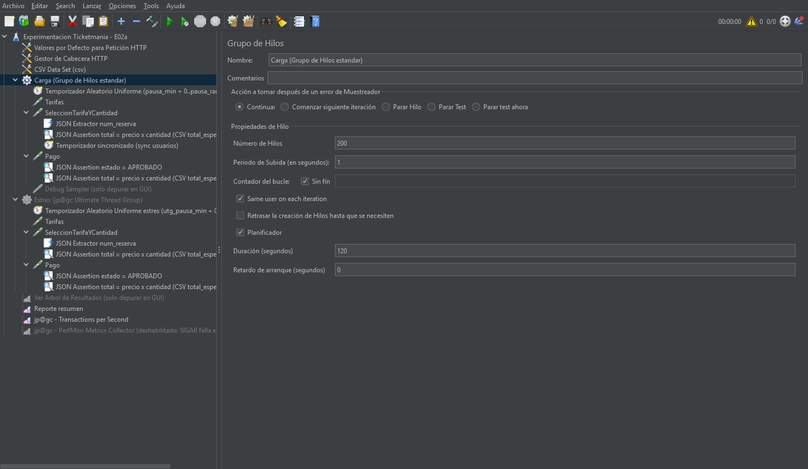


**Resultados observados:**

| Métrica | Ramp-up 1 s (E02a) | Ramp-up 60 s (E02b) |
|---|---|---|
| Primer segundo: peticiones | 169 | 8 |
| Primer segundo: media / p95 / máx | 10,0 / 63 / 95 ms | 17,0 / 48 / 48 ms (8 peticiones) |
| Primeros 10 s: errores | 10 (conexión rechazada) | 0 |
| Resto (10–120 s): p95 / máx | 5 / 48 ms | 3 / 13 ms |
| Total: media / p95 / máx | 3,15 / 6 / 95 ms | 2,32 / 3 / 48 ms |
| Total: % Error | 0,26 % | 0,01 % |

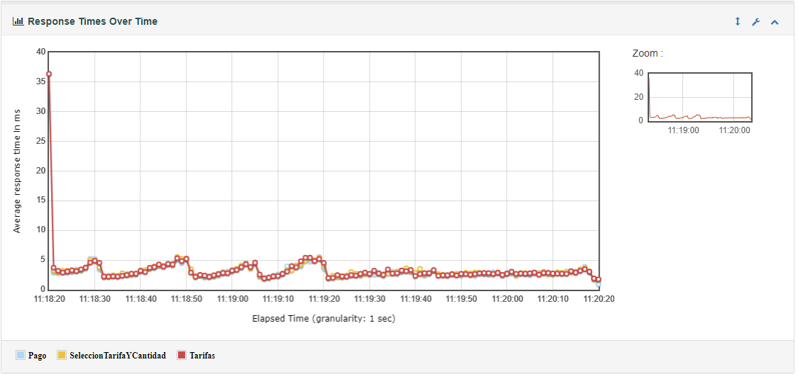
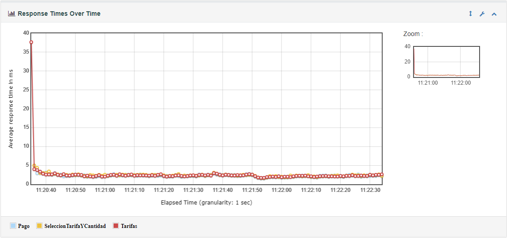

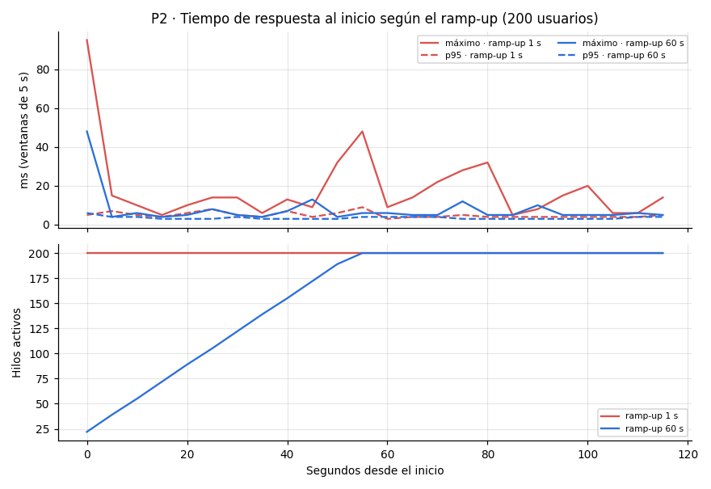

**Respuesta:**

Sí cambia. Con ramp-up de 1 s los 200 usuarios llegan casi juntos: en el primer segundo hubo 169 peticiones, el máximo llegó a 95 ms, el p95 de ese segundo fue de 63 ms y 10 conexiones fueron rechazadas. Con ramp-up de 60 s el primer segundo tuvo solo 8 peticiones: el máximo de 48 ms es el calentamiento de la primera petición (primera conexión), no una cola, y no hubo errores.

Además, con la subida de 1 s los usuarios quedan «sincronizados» y llegan en oleadas durante toda la prueba: el máximo después del inicio siguió en 48 ms, contra 13 ms con 60 s. Una subida gradual reparte la llegada y evita el pico; una subida brusca crea un pico inicial y errores aunque el número de usuarios sea el mismo.

**Qué no pude medir / qué cambió el resultado:** El pico de la primera petición (calentamiento de JMeter y de la primera conexión) aparece en los dos casos y no lo puedo separar del todo del efecto del ramp-up. Fue una sola ejecución de cada uno: 10 errores son pocos para calcular un porcentaje preciso.

---

## P3 · CARGA: ¿Qué pasaría si quito los temporizadores? ¿Cuánto sube el throughput y qué significa eso para la prueba?

**Qué cambia:** Temporizador (500–1500 ms → 0 ms), con 20 usuarios.  
**Métrica elegida:** Throughput total y exitoso (throughput × (1 − %error)), % Error, Media y p95.

| Escenario | E01a (con temporizador) | E03 (sin temporizador) |
|---|---|---|
| Hilos | 20 | 20 |
| Subida (ramp-up) | 10 s | 10 s |
| Duración | 60 s | 60 s |
| Temporizador | Temporizador Aleatorio Uniforme: 500 ms + 0–1000 ms (pausas de 0,5 a 1,5 s) | Mismo elemento con 0 ms + 0 ms (sin pausas) |

**Escenario configurado en JMeter:**

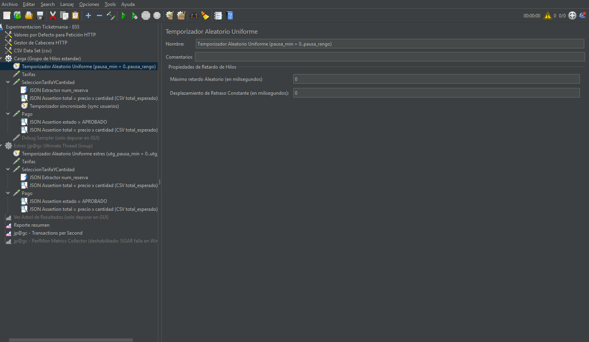

**Resultados observados:**

| Métrica | Con temporizador (E01a) | Sin temporizador (E03) |
|---|---|---|
| Muestras | 1 100 | 90 598 |
| Throughput (todas) | 18,8 pet/s | 1 513,8 pet/s (×80) |
| Throughput exitoso | 18,8 pet/s | 329,6 pet/s (×17,5) |
| % Error | 0 % | 78,23 % |
| Media / p95 | 2,39 / 3 ms | 11,66 / 34 ms |
| CPU de JMeter (media / máx.) | 1,2 % / 16 % | 29,7 % / 64 % |
| CPU del equipo (máx.) | 25 % | 81 % |

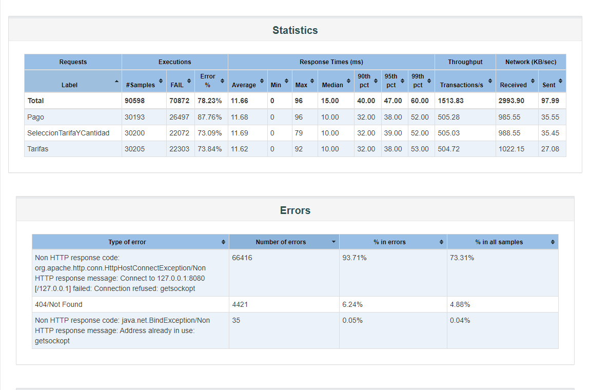

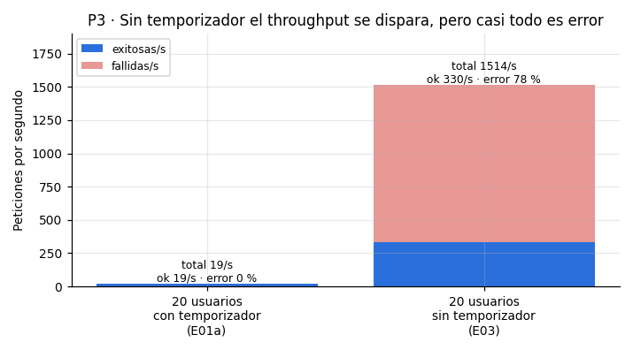

**Respuesta:**

El throughput sube unas 80 veces (18,8 → 1 513,8 pet/s), pero ese número engaña: el 78 % fueron errores. Sin pausas, cada hilo dispara una petición apenas recibe la anterior, así que 20 hilos ya no representan 20 personas sino un bombardeo continuo. La API solo logró completar unas 330 peticiones por segundo (×17,5) y rechazó el resto; el p95 de las correctas subió a 45 ms.

Para la prueba significa que deja de ser una prueba de carga realista y se vuelve una prueba de estrés: mide cuánto aguanta la API (y el propio JMeter, que llegó al 64 % del CPU), no cómo se comporta con usuarios reales. Los temporizadores son los que modelan el tiempo que una persona tarda entre clic y clic.

**Qué no pude medir / qué cambió el resultado:** Sin pausas el generador consume buena parte del CPU, así que el límite de unas 330 pet/s exitosas es del conjunto JMeter + API en este equipo, no solo de la API. El 404 de Pago infla el porcentaje de error de esa petición.

---

## P4 · ESTRÉS: ¿Qué pasaría si escalono de 50 a 100, 250 y 500 usuarios? ¿En qué punto deja de crecer el throughput?

**Qué cambia:** Usuarios activos en escalones durante la misma prueba.  
**Métrica elegida:** Throughput por segundo (Hits per Second) frente a hilos activos; errores y p95.

| Elemento | Configuración (E04) |
|---|---|
| Tipo de hilo | jp@gc Ultimate Thread Group |
| Escalón 1 | +50 hilos en t = 0 s (total 50), subida de 10 s |
| Escalón 2 | +50 hilos en t = 30 s (total 100), subida de 10 s |
| Escalón 3 | +150 hilos en t = 60 s (total 250), subida de 10 s |
| Escalón 4 | +250 hilos en t = 90 s (total 500), subida de 10 s |
| Mantener / bajada | Todos hasta t ≈ 150 s; bajada de 5 s |
| Temporizador | Temporizador Aleatorio Uniforme: 500 ms + 0–1000 ms (pausas de 0,5 a 1,5 s) |

**Escenario configurado en JMeter:**

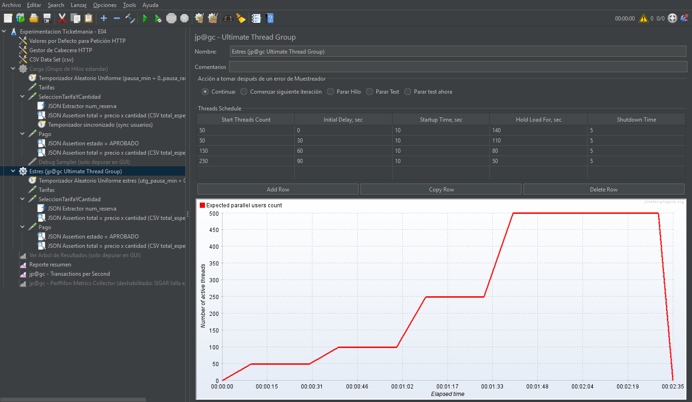
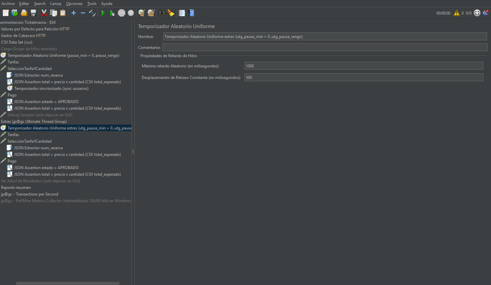

**Resultados observados:**

| Escalón | Hilos | Peticiones exitosas por segundo | Errores |
|---|---|---|---|
| 1 | 50 | ≈ 49–51 | 0 |
| 2 | 100 | ≈ 98–101 | 0 |
| 3 | 250 | ≈ 249–251 | 0 |
| 4 (primeros 20 s) | 500 | ≈ 500 | 1–3 por cada 10 s |
| 4 (siguientes 30 s) | 500 | 477 → 491 → 461 → 354 | 161, 275 y 361 conexiones rechazadas; 831 BindException en los últimos 10 s |
| Total |  | 40 277 muestras; throughput 262 pet/s | 6,44 % |

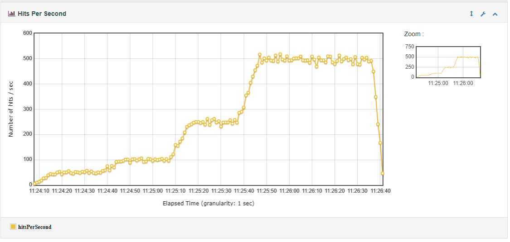
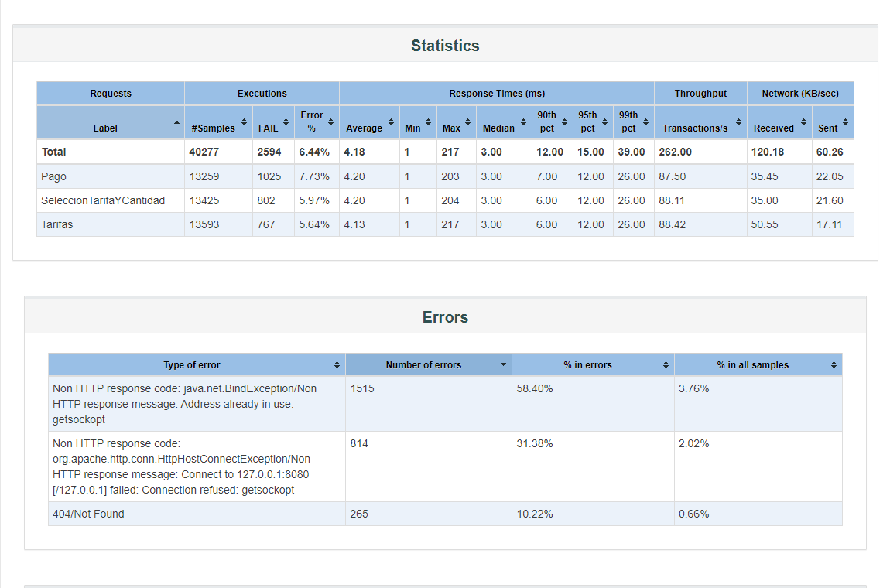

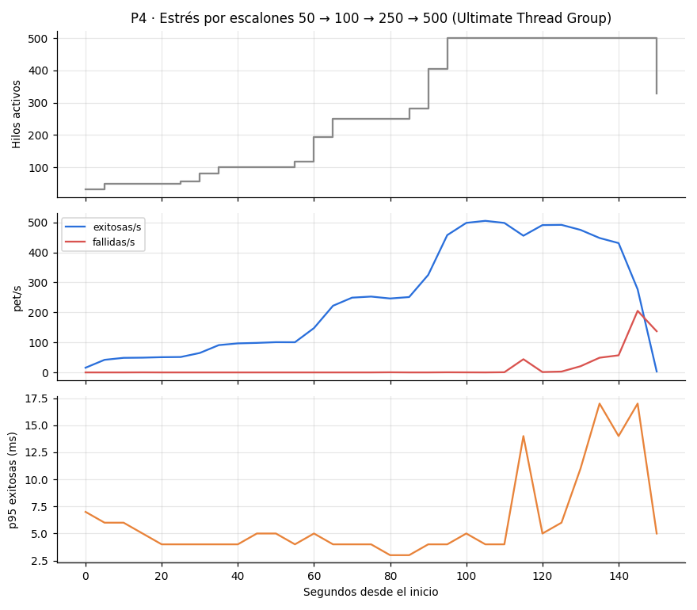

**Respuesta:**

Hasta 250 usuarios el throughput creció en línea recta, cerca de 1 petición por segundo por usuario (50 → 100 → 250 pet/s), sin errores y con el p95 en 3–4 ms. En el escalón de 500 subió hasta unas 500 pet/s, pero ahí dejó de crecer: tras unos 20 s sostenidos empezaron las conexiones rechazadas, el throughput exitoso bajó a 461 y luego a 354 pet/s, y el p95 subió a 15 ms.

El punto de quiebre en este equipo está entre 250 y 500 usuarios, alrededor de 500 pet/s. No es por CPU (la API usó como máximo el 5,6 % del equipo), sino por las conexiones: la API abre una conexión TCP por petición y su cola de aceptación es pequeña. Al final también se agotaron los puertos del equipo (BindException).

**Qué no pude medir / qué cambió el resultado:** El escalón de 500 duró unos 50 s, así que no sé si se habría estabilizado o seguido cayendo. El agotamiento de puertos es un límite del lado de JMeter que aparece porque todo corre en el mismo equipo; con la API en un servidor dedicado el punto de quiebre podría ser otro.

---

## P5 · ESTRÉS: ¿Qué pasaría si la prueba dura 10 minutos en lugar de 1? ¿El tiempo de respuesta se mantiene o sube con el tiempo?

**Qué cambia:** Duración (60 s → 600 s), con 50 usuarios.  
**Métrica elegida:** Media y p95 por minuto (Response Times Over Time) y memoria de la API.

| Escenario | E05a | E05b |
|---|---|---|
| Hilos | 50 | 50 |
| Subida (ramp-up) | 10 s | 10 s |
| Duración | 60 s | 600 s (10 min) |
| Temporizador | Temporizador Aleatorio Uniforme: 500 ms + 0–1000 ms (pausas de 0,5 a 1,5 s) | Temporizador Aleatorio Uniforme: 500 ms + 0–1000 ms (pausas de 0,5 a 1,5 s) |

**Escenario configurado en JMeter:**


**Resultados observados:**

| Métrica | 1 minuto (E05a) | 10 minutos (E05b) |
|---|---|---|
| Muestras | 2 724 | 29 694 |
| Throughput | 46,0 pet/s | 49,6 pet/s |
| Media / p95 / máx | 2,22 / 3 / 49 ms | 2,05 / 3 / 35 ms |
| % Error | 0 % | 0 % |
| Media por minuto (E05b) |  | 2,36 · 2,10 · 1,99 · 1,93 · 1,90 · 2,06 · 2,05 · 1,90 · 2,06 · 2,16 ms |
| p95 por minuto (E05b) |  | 3 ms en los 10 minutos |
| Memoria de la API | 24,4 → 24,4 MB | 24,4 → 24,5 MB |

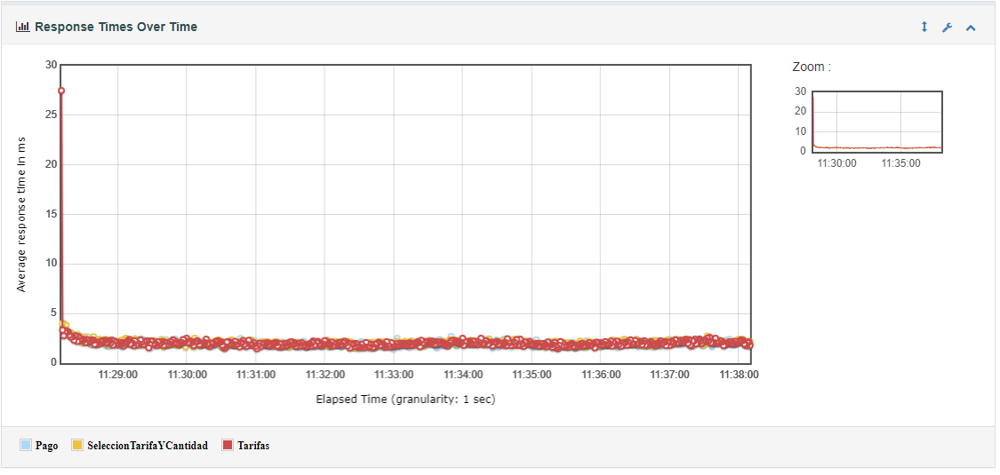

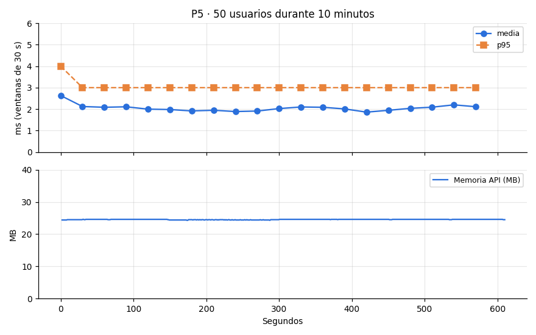

**Respuesta:**

El tiempo de respuesta se mantiene. En los 10 minutos la media estuvo entre 1,90 y 2,36 ms por minuto y el p95 fue de 3 ms en todos; el minuto más lento fue el primero, por el calentamiento, no el último. La memoria de la API prácticamente no cambió (24,4 → 24,5 MB): no hay señales de degradación ni de que algo se acumule con este nivel de carga.

**Qué no pude medir / qué cambió el resultado:** 10 minutos con 50 usuarios es corto para una prueba de resistencia real (el ejemplo de la guía habla de 200 usuarios durante 30 minutos). Todas las reservas se pagan y la API las borra; no probé reservas que nunca se pagan, que quedarían en memoria indefinidamente. Qué cambió el resultado: la primera ejecución de E05a tuvo un 0,15 % de errores porque arrancó con los puertos de la prueba anterior todavía ocupados; con la espera entre escenarios, 0 %.

---

## P6 · ESTRÉS: ¿Qué pasaría si mido /api/tarifas (solo lectura) y /api/seleccion (crea reservas) con la misma carga? ¿Cuál cuesta más?

**Qué cambia:** La petición (se comparan las filas Tarifas y SeleccionTarifaYCantidad de la misma ejecución).  
**Métrica elegida:** Costo = columna Media del reporte (ms) de cada petición; p95 como apoyo.

| Elemento | Configuración (E06) |
|---|---|
| Hilos | 100 |
| Subida (ramp-up) | 10 s |
| Duración | 60 s |
| Temporizador | Temporizador Aleatorio Uniforme: 500 ms + 0–1000 ms (pausas de 0,5 a 1,5 s) |
| Misma carga | Cada usuario hace Tarifas y luego Selección: 1 851 y 1 815 peticiones |

**Escenario configurado en JMeter:**


**Resultados observados:**

| Petición | Muestras | Media (costo) | p95 | Máx |
|---|---|---|---|---|
| /api/tarifas (GET) | 1 851 | 2,17 ms | 3 ms | 45 ms |
| /api/seleccion (POST) | 1 815 | 2,21 ms | 3 ms | 6 ms |
| /api/pago (POST) | 1 785 | 2,17 ms | 3 ms | 4 ms |
| Con 500 usuarios (E01b): tarifas / selección |  | 3,64 / 3,71 ms | 8 / 8 ms |  |

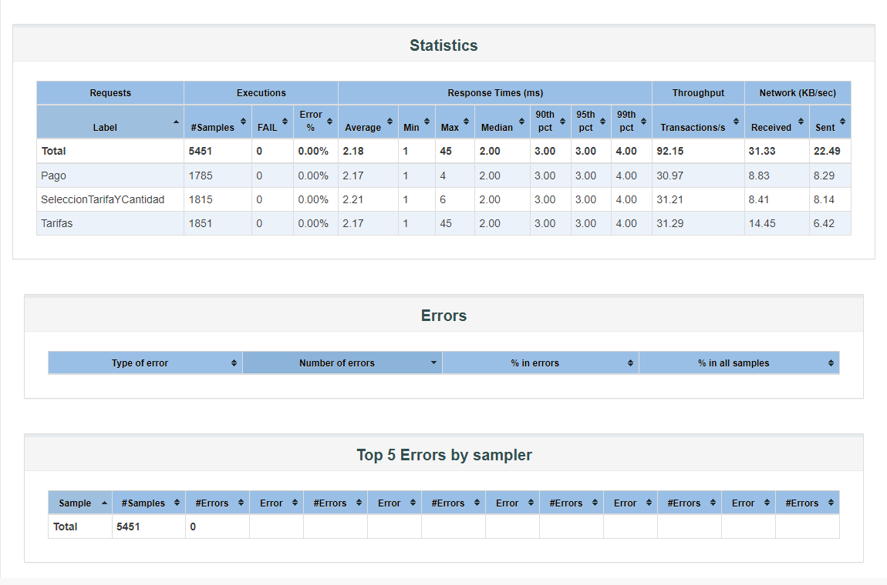

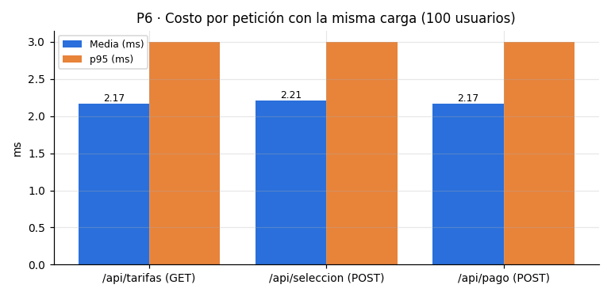

**Respuesta:**

La más costosa es /api/seleccion, pero por muy poco: 2,21 ms contra 2,17 ms de /api/tarifas (unos 0,04 ms, ≈ 2 %). Con 500 usuarios pasa lo mismo: 3,71 contra 3,64 ms. Tiene sentido: Selección lee y valida el JSON del cuerpo, genera un identificador, toma un candado y escribe la reserva en memoria, mientras que Tarifas solo devuelve una lista fija.

En la práctica cuestan casi lo mismo en esta API: la diferencia está en el orden del ruido. El máximo mayor de Tarifas (45 ms) no es porque sea más costosa: es la primera petición de la prueba, que paga el calentamiento.

**Qué no pude medir / qué cambió el resultado:** La diferencia es menor que la resolución de JMeter (mide en milisegundos enteros) y es una sola ejecución, así que no puedo afirmar con certeza que sea real. Con una base de datos real, la escritura de Selección costaría bastante más que una lectura.

---

## P7 · CONCURRENCIA: ¿Qué pasaría si 500 usuarios crean reservas al mismo tiempo? ¿Todas las respuestas son exitosas?

**Qué cambia:** Llegada simultánea: Temporizador sincronizado con grupo de 500 en la petición de Selección.  
**Métrica elegida:** % Error de SeleccionTarifaYCantidad, Media y Máx, y que cada reserva creada se pague con estado APROBADO y total correcto.

| Elemento | Configuración (E07) |
|---|---|
| Hilos | 500 |
| Subida (ramp-up) | 10 s |
| Contador del bucle | 1 (cada usuario hace el flujo una vez) |
| Temporizador sincronizado | Número de usuarios a agrupar: 500; timeout de 30 000 ms (hijo de SeleccionTarifaYCantidad) |
| Temporizador aleatorio | Temporizador Aleatorio Uniforme: 500 ms + 0–1000 ms (pausas de 0,5 a 1,5 s) |

**Escenario configurado en JMeter:**

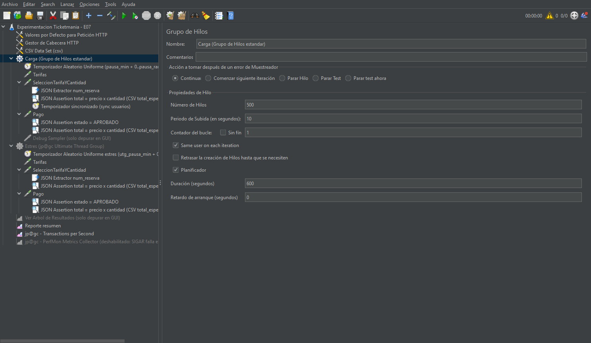


**Resultados observados:**

| Métrica | Valor (E07) |
|---|---|
| Selecciones enviadas | 500 en ≈ 1 s (483 en el mismo segundo) |
| Selecciones exitosas | 498 de 500 (99,6 %) |
| Errores en Selección | 2 conexiones rechazadas (HttpHostConnectException) |
| Pagos | 498 APROBADO con total correcto; 2 respuestas 404 (las reservas que no se crearon) |
| Selección: media / p95 / máx | 3,05 / 6 / 14 ms |
| % Error total | 0,27 % (4 de 1 500 muestras) |

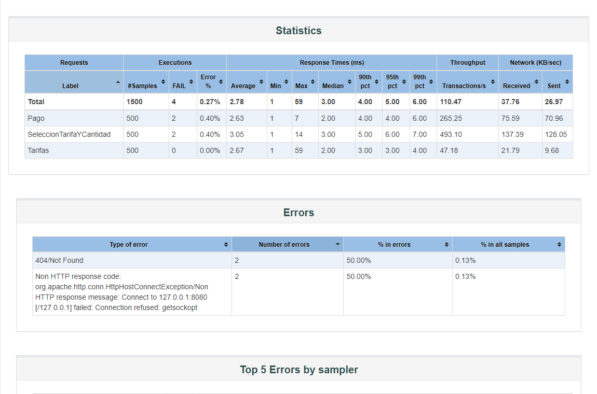


**Respuesta:**

No todas. Al liberar 500 selecciones en el mismo segundo, 498 fueron exitosas y 2 fueron rechazadas: la API no alcanzó a aceptar esas conexiones porque su cola de aceptación se llenó en ese instante. Los 2 pagos de esas reservas inexistentes respondieron 404.

Las que entraron respondieron rápido (máximo 14 ms) y sin inconsistencias: no hubo reservas duplicadas ni totales mal calculados, gracias a los identificadores únicos y al candado (lock) que protege el diccionario de reservas.

**Qué no pude medir / qué cambió el resultado:** El temporizador sincroniza el envío en JMeter, pero el sistema operativo puede reordenar o retrasar las conexiones. Con una sola ejecución, 2 errores son muy pocos para estimar la tasa de rechazo, y el rechazo depende de cómo Windows maneja la cola del servidor.

---

## P8 · CONCURRENCIA: ¿Qué pasaría si los usuarios disparan a la vez con el Temporizador sincronizado, frente a cuando llegan distribuidos?

**Qué cambia:** Temporizador sincronizado (grupo de 500 → grupo de 1, es decir, sin sincronizar). Mismos 500 usuarios, misma subida y bucle 1.  
**Métrica elegida:** Concentración de llegadas, Media, p95 y Máx de Selección, y % Error.

| Escenario | E07 (sincronizado) | E08 (distribuido) |
|---|---|---|
| Hilos | 500 | 500 |
| Subida (ramp-up) | 10 s | 10 s |
| Contador del bucle | 1 | 1 |
| Temporizador sincronizado | Grupo de 500 | Grupo de 1 (no sincroniza) |
| Temporizador aleatorio | Temporizador Aleatorio Uniforme: 500 ms + 0–1000 ms (pausas de 0,5 a 1,5 s) | Temporizador Aleatorio Uniforme: 500 ms + 0–1000 ms (pausas de 0,5 a 1,5 s) |

**Escenario configurado en JMeter:**

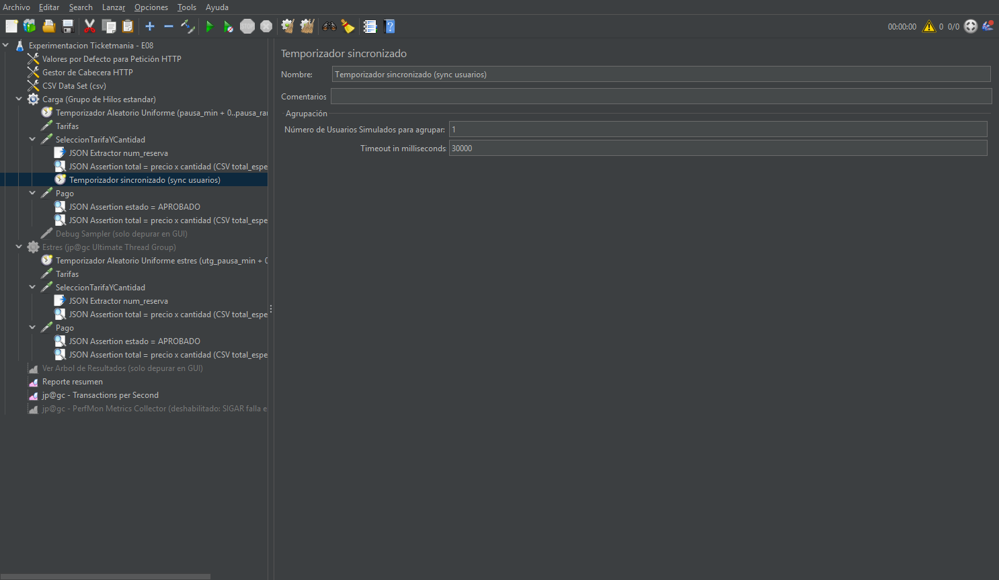

**Resultados observados:**

| Métrica | Sincronizados (E07) | Distribuidos (E08) |
|---|---|---|
| Las 500 selecciones llegaron en | ≈ 1 s | ≈ 11 s |
| Máx. selecciones en un segundo | 483 | 57 |
| Selección: media / p95 / máx | 3,05 / 6 / 14 ms | 2,50 / 4 / 5 ms |
| Errores | 2 rechazos + 2 × 404 (0,27 %) | 0 (0 %) |
| Duración total / throughput | 14 s / 110 pet/s | 13 s / 116 pet/s |

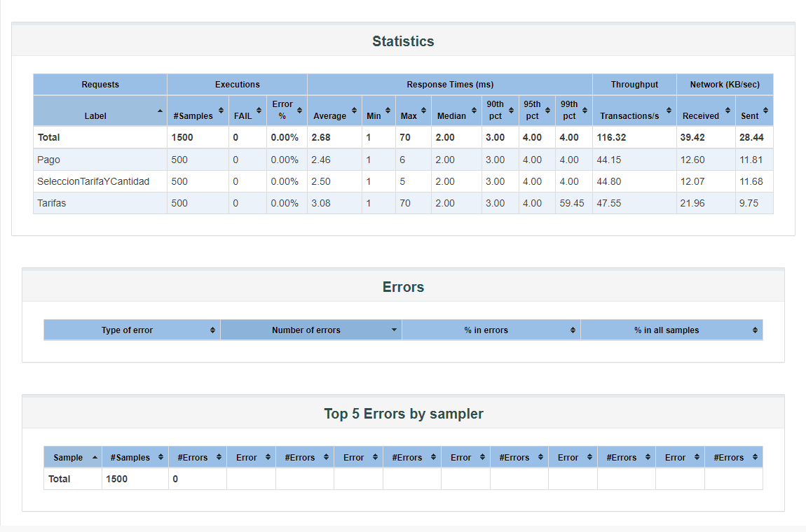


**Respuesta:**

Con los mismos 500 usuarios y el mismo trabajo total, el patrón de llegada cambia el resultado. Sincronizados, unas 480 peticiones caen en el mismo segundo: el p95 de Selección sube un 50 % (4 → 6 ms), el máximo casi se triplica (5 → 14 ms) y aparecen conexiones rechazadas. Distribuidos, la API atiende como máximo 57 selecciones por segundo y no hay ningún error.

La concurrencia, es decir, cuántos llegan en el mismo instante, afecta más que la cantidad total de usuarios.

**Qué no pude medir / qué cambió el resultado:** Las diferencias absolutas son de pocos milisegundos y cada escenario se ejecutó una sola vez. Con 500 usuarios distribuidos en 10 s no se ve el límite; haría falta repetir con más usuarios o más iteraciones.

---

## P9 · CONCURRENCIA: ¿Qué pasaría si el total cobrado no coincide con precio × cantidad bajo carga? ¿Cómo lo validarías con el CSV?

**Qué cambia:** Validación del total bajo carga (E09a) y control del validador con un total mal calculado a propósito (E09b).  
**Métrica elegida:** % Error causado por la JSON Assertion del total y el mensaje de la aserción en el reporte.

| Elemento | E09a (bajo carga) | E09b (control del validador) |
|---|---|---|
| CSV Data Set | datos.csv: tarifa, cantidad, total_esperado (24 filas) | datos_control_total_erroneo.csv: 3 filas, una con vip,3 = 1 000 000 (el correcto es 1 050 000) |
| Aserción | JSON Assertion en Selección y en Pago: $.total = ${total_esperado} | La misma |
| Hilos / subida / duración | 200 / 10 s / 60 s | 5 / 1 s / 10 s |
| Temporizador | Temporizador Aleatorio Uniforme: 500 ms + 0–1000 ms (pausas de 0,5 a 1,5 s) | Temporizador Aleatorio Uniforme: 500 ms + 0–1000 ms (pausas de 0,5 a 1,5 s) |

**Escenario configurado en JMeter:**

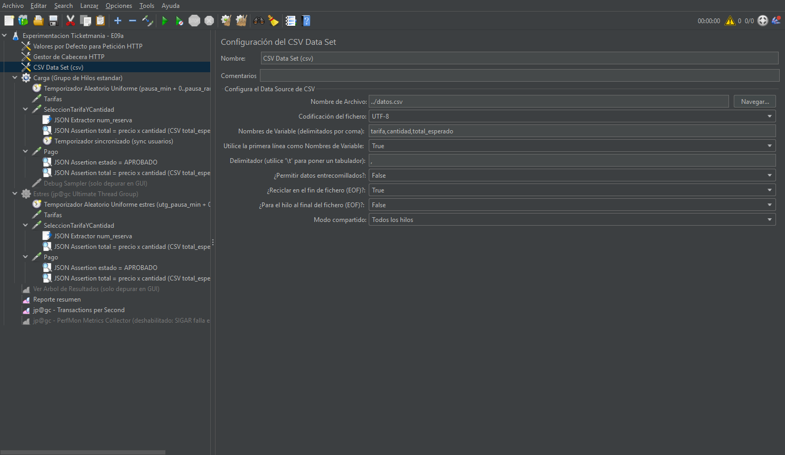
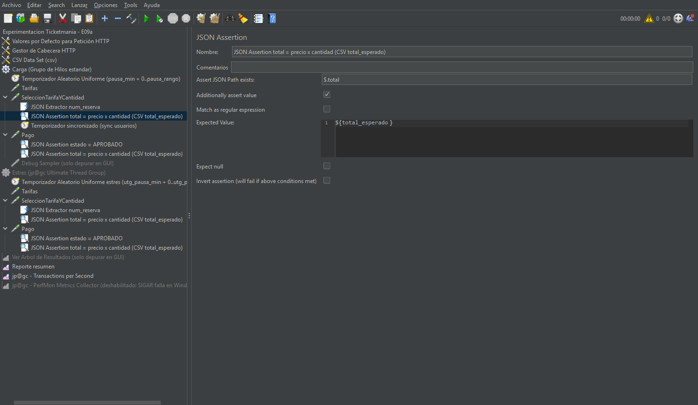

**Resultados observados:**

| Métrica | E09a (200 usuarios) | E09b (control) |
|---|---|---|
| Muestras | 10 913 | 44 |
| Totales validados | 3 641 selecciones + 3 569 pagos, todos correctos | Fallan exactamente las filas vip,3 |
| % Error | 0 % | 20,45 % (5 Selección + 4 Pago) |
| Mensaje | — | Value in json path '$.total' expected to be '1000000' |

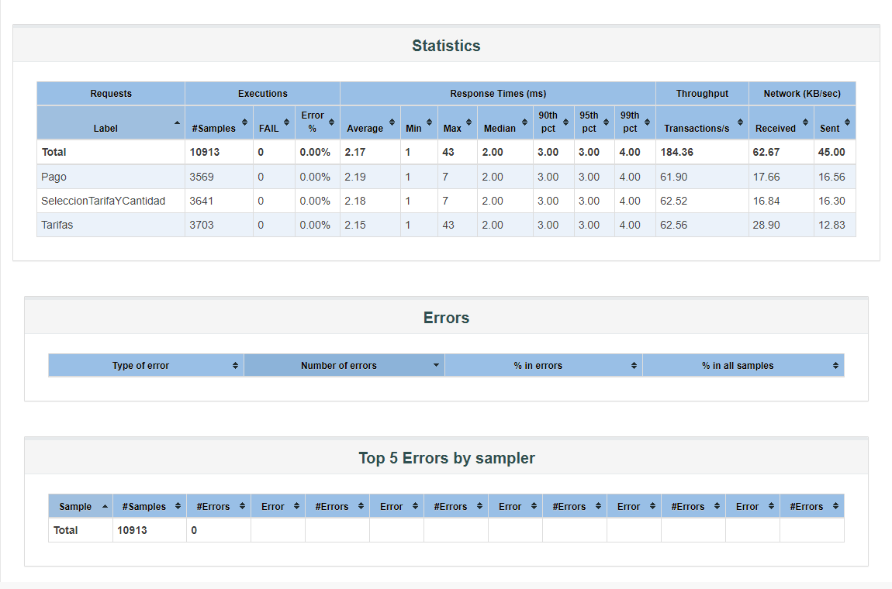
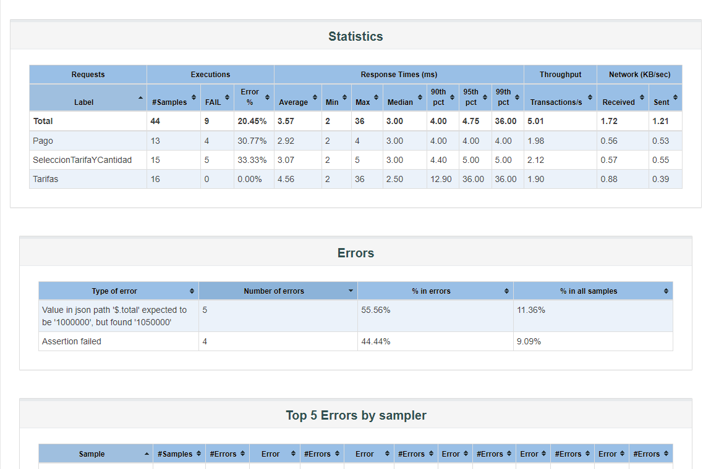


**Respuesta:**

Lo validé con el CSV: agregué la columna total_esperado (precio × cantidad, calculada de antemano para las 24 combinaciones) y una JSON Assertion que compara $.total de la respuesta con ${total_esperado}, en Selección y en Pago. Como cada hilo lee su propia fila, cada petición lleva su resultado esperado, y la validación sigue funcionando con muchos usuarios a la vez.

Bajo carga (200 usuarios, 10 913 peticiones) el total siempre coincidió: 0 % de errores. Si no coincidiera, JMeter marcaría esas muestras como fallidas, con el mensaje de la aserción en la tabla Errors. Eso es justo lo que pasó en el control E09b, donde puse un total incorrecto a propósito: fallaron exactamente las peticiones de esa fila.

**Qué no pude medir / qué cambió el resultado:** Solo valida las combinaciones que están en el CSV (cantidades de 1 a 6). No prueba cantidades muy grandes ni cambios de precio durante la prueba (los precios son constantes en la API). El control E09b comprueba el validador, no la API: no es un caso negativo de la API.

---

## P10 · MEDICIÓN DE RECURSOS: ¿Qué pasaría si subo a 500 usuarios? ¿Cómo se comportan la memoria y la CPU durante la prueba? ¿Llegan a saturarse? ¿Cuánto cambia el tiempo de respuesta cuando eso pasa?

**Qué cambia:** 500 usuarios con subida lenta (60 s) para ver cuándo empieza el problema; monitoreo de CPU y memoria cada segundo.  
**Métrica elegida:** Hardware: CPU (%) y memoria del equipo, de la API y de JMeter. Rendimiento: peticiones exitosas por segundo, p95 y errores en el tiempo.

| Elemento | Configuración (E10) |
|---|---|
| Hilos | 500 |
| Subida (ramp-up) | 60 s |
| Duración | 180 s |
| Temporizador | Temporizador Aleatorio Uniforme: 500 ms + 0–1000 ms (pausas de 0,5 a 1,5 s) |
| Monitoreo | psutil, 1 muestra por segundo (en lugar de PerfMon, que no funcionó) |

**Escenario configurado en JMeter:**


**Resultados observados:**

| Momento | Exitosas/s | p95 | Qué pasó |
|---|---|---|---|
| 0–50 s (subida) | 45 → 460 | 3–4 ms | Sin errores |
| 50–80 s (500 usuarios) | ≈ 490–495 | 5–8 ms | Algunas conexiones rechazadas |
| 90–100 s | 463 → 176 | 13–21 ms | Rechazos y comienzan las BindException |
| 110–140 s | 0 → 49 | hasta 25 ms | ≈ 4 900 BindException cada 10 s (sin puertos) |
| 150–180 s | 134 → 331 | hasta 50 ms | Recuperación parcial |
| Total | 74 231 muestras | p95 25 ms · máx 176 ms | 40,23 % de error |

**CPU y memoria (psutil):**

| Recurso | Inicio | Máximo | ¿Se satura? |
|---|---|---|---|
| CPU del equipo | ≈ 18 % | 37 % | No |
| CPU de la API | 0,2 % | 4,9 % | No |
| CPU de JMeter | 3 % | 23 % | No |
| Memoria del equipo | 77 % | 81 % | No (estable) |
| Memoria de la API | 24,4 MB | 25,3 MB | No |
| Memoria de JMeter | 282 MB | 877 MB | Crece (guarda resultados) |

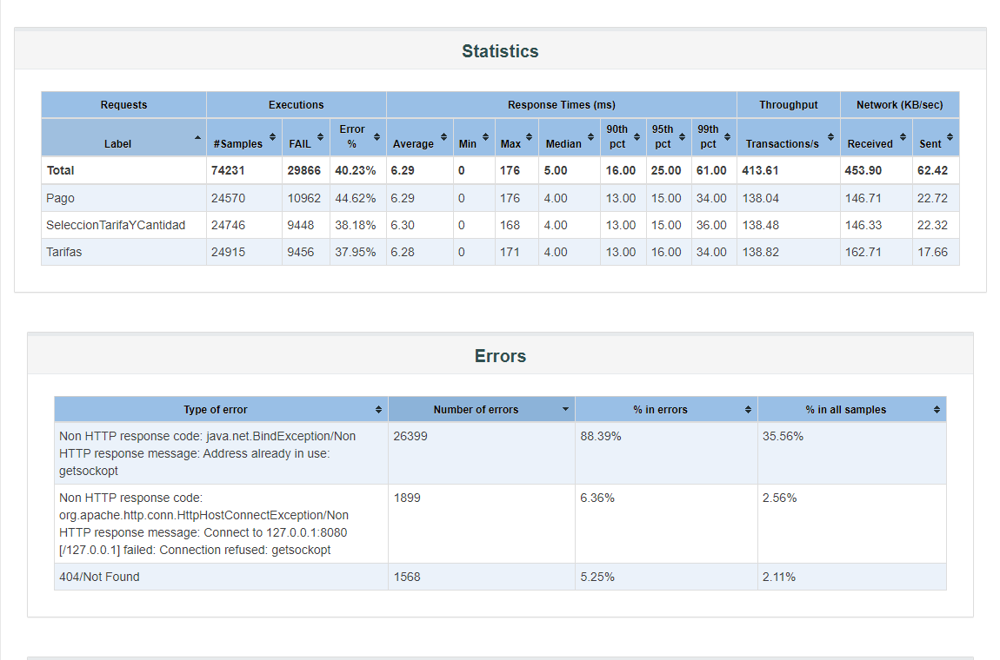

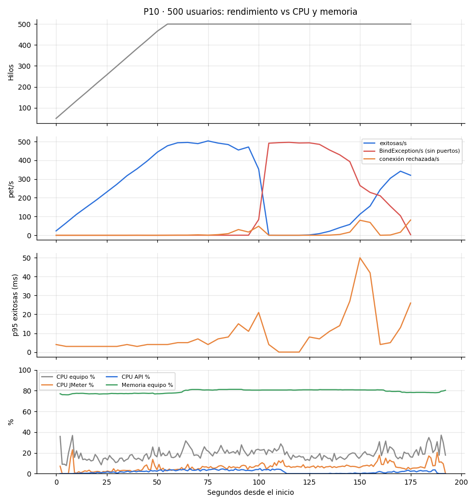
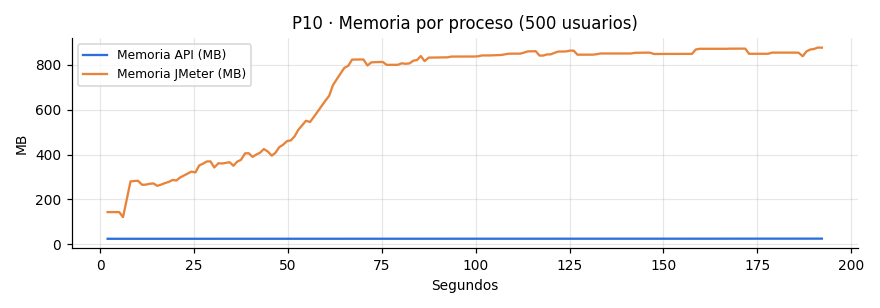

**Respuesta:**

Ni la CPU ni la memoria se saturaron: el equipo llegó como máximo al 37 % de CPU, la API al 4,9 % y la memoria de la API casi no cambió (24,4 → 25,3 MB). Aun así, el rendimiento colapsó. Mientras la carga subía, la API respondía en 3–4 ms; con 500 usuarios sostenidos, el p95 pasó a 13–21 ms, y entre los segundos 110 y 140 las peticiones exitosas cayeron casi a cero, con un p95 de hasta 50 ms en la recuperación.

Lo que se saturó fueron las conexiones TCP, no el hardware. La API usa HTTP/1.0 (una conexión nueva por petición) con una cola de aceptación pequeña, y a unas 500 conexiones por segundo el equipo agotó sus 16 384 puertos dinámicos (java.net.BindException del lado de JMeter). Por eso hardware y rendimiento se miden juntos pero se leen por separado: el CPU bajo no garantiza buen rendimiento.

**Qué no pude medir / qué cambió el resultado:** PerfMon no funcionó (SIGAR se cae en Windows 11) y usé psutil. El agotamiento de puertos ocurre porque JMeter y la API están en el mismo equipo: con la API en un servidor dedicado el resultado sería distinto. La memoria de JMeter creció hasta 877 MB, otra razón para usar no-GUI y pocos listeners.

---

## Conclusiones

- Con usuarios realistas (pausas de 0,5–1,5 s) la API responde en 2–4 ms y escala casi lineal hasta 250 usuarios (≈ 250 pet/s) sin errores (P1, P4), y se mantiene estable durante 10 minutos (P5).
- El límite aparece por la forma de llegada más que por la cantidad: subida brusca (P2), sin temporizadores (P3) o llegadas sincronizadas (P7, P8) producen picos y rechazos que no aparecen con llegadas distribuidas.
- El recurso que se agota es la conexión TCP (cola de aceptación de la API y puertos del equipo), no el CPU ni la memoria (P4, P10).
- Las aserciones con datos del CSV permiten validar la lógica de negocio (el total) mientras hay carga (P9).

## Reproducir

```bash
pip install psutil matplotlib
JMETER_HOME=/ruta/apache-jmeter-5.6.3 JAVA=/ruta/jdk-17/bin/java python run_experimentos.py   # todos los escenarios
python graficas.py
```
