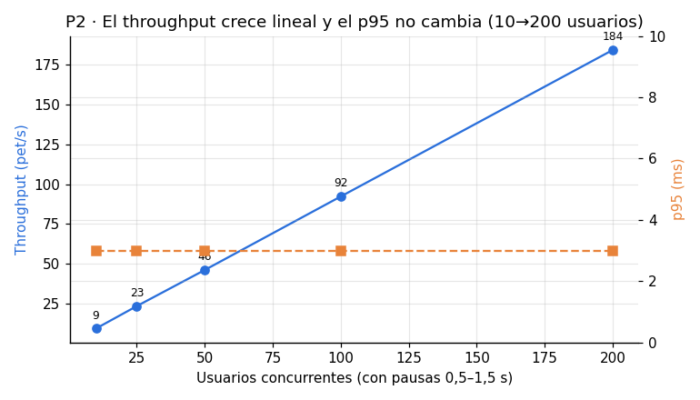
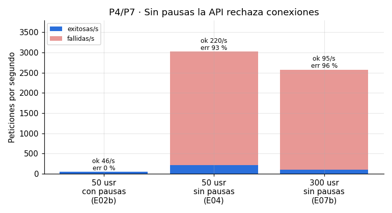
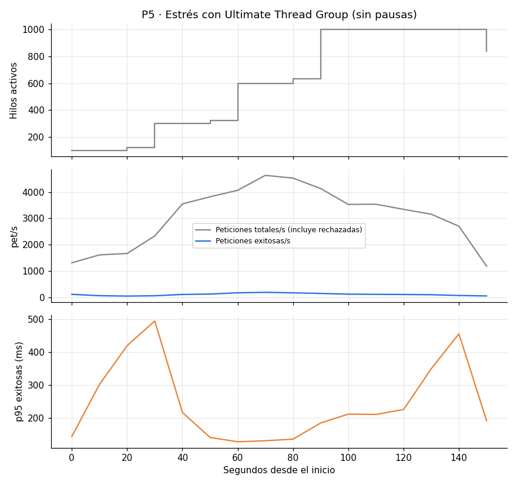
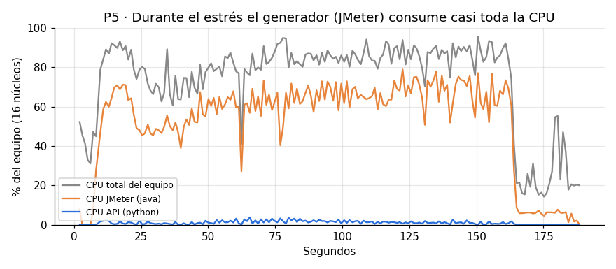
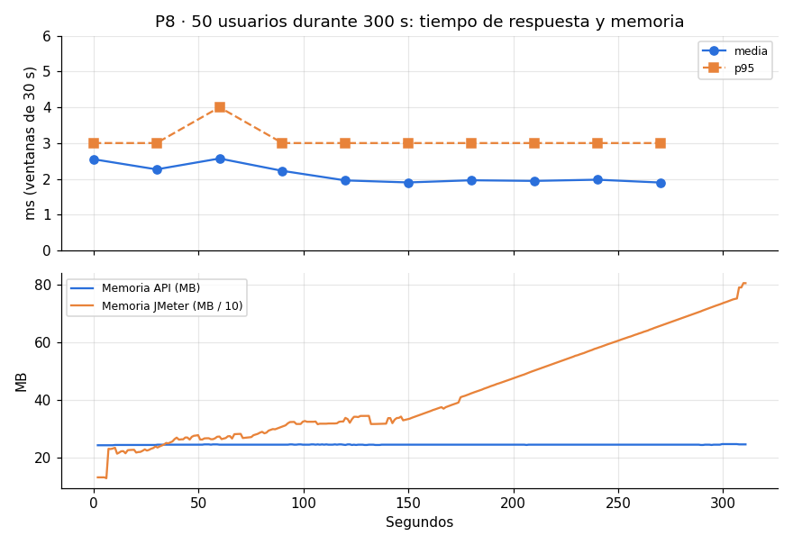

# Ejercicio 2 · Experimentación individual con JMeter (Tiquetmania)

Plan independiente del pipeline: [`experimentacion.jmx`](experimentacion.jmx). Todos los valores de este
documento salen de las ejecuciones en modo no-GUI guardadas en [`resultados/`](resultados/). Cada escenario
tiene su reporte HTML (`resultados/<ID>/reporte/index.html`), sus métricas (`metricas.json`), el uso de CPU y
memoria (`recursos.csv`) y el `.jtl` crudo comprimido. La tabla completa está en
[`resultados/resumen.md`](resultados/resumen.md) y las gráficas en [`resultados/graficas/`](resultados/graficas/).

## Entorno y método

| Aspecto | Valor |
|---|---|
| Equipo | AMD Ryzen 7 4800H (8 núcleos / 16 hilos), 15,4 GB RAM, Windows 11 |
| Software | Apache JMeter 5.6.3 con Java 17 (Microsoft OpenJDK 17.0.20), Python 3.13 para la API |
| Plugins | jpgc Standard (Transactions per Second), jpgc PerfMon y jpgc Custom Thread Groups (Ultimate Thread Group) |
| API | `api/ticketmania_simple.py` en `127.0.0.1:8080`, **reiniciada antes de cada escenario** (memoria limpia) |
| Flujo por usuario | `GET /api/tarifas` → `POST /api/seleccion` (JSON Extractor `num_reserva`) → `POST /api/pago` (JSON Assertion `$.estado = APROBADO`) |
| Ejecución | `run_experimentos.py`: `java -jar ApacheJMeter.jar -n -t experimentacion.jmx -J<prop>=<valor> -l resultados.jtl -e -o reporte` |
| Hardware | PerfMon + ServerAgent 2.2.1 **no funcionó**: la librería SIGAR produce `EXCEPTION_ACCESS_VIOLATION` en `sigar-amd64-winnt.dll` con Windows 11 (el riesgo que menciona la guía). Lo reemplacé con un monitor en Python (`psutil`), que toma 1 muestra por segundo del CPU y la memoria del equipo, del proceso de la API y del proceso de JMeter. El colector PerfMon queda en el plan, deshabilitado. |

**Cómo se respeta "una variable por ejecución".** El plan está parametrizado con propiedades
(`${__P(hilos,10)}`, `${__P(rampup,10)}`, `${__P(duracion,60)}`, `${__P(bucles,-1)}`, `${__P(pausa_min,500)}`,
`${__P(pausa_rango,1000)}`, `${__P(sync,1)}`, `${__P(csv,datos.csv)}`, `${__P(conexion,keep-alive)}`,
`${__P(utg1..utg4,0)}`). Los valores base (10 usuarios, ramp-up de 10 s, 60 s, pausas de 0,5–1,5 s,
keep-alive y CSV mixto) solo se cambian con `-J` en lo que cada escenario declara en `run_experimentos.py`. El
plan nunca se edita entre corridas.

**Elementos de JMeter utilizados:** Grupo de Hilos estándar con planificador (duración) y contador de
bucle; **Ultimate Thread Group** (estrés por escalones); **Temporizador Aleatorio Uniforme** (tiempo de
pensamiento); **Temporizador Sincronizado** (concurrencia real); CSV Data Set; Valores por Defecto HTTP;
Gestor de Cabecera HTTP; JSON Extractor; JSON Assertion; Reporte resumen; jp@gc Transactions per Second; Debug
Sampler y Ver Árbol de Resultados (estos dos **deshabilitados**, porque solo sirven para depurar en GUI).

**Depuración en GUI y medición en no-GUI.** Primero se abre `experimentacion.jmx` en la GUI, se habilitan el
Debug Sampler y el Árbol de Resultados, y se ejecuta con pocos hilos para comprobar que `num_reserva` se
extrae y que el pago responde `APROBADO`. Después se deshabilitan y se mide solo en no-GUI, porque la interfaz
y el Árbol de Resultados consumen CPU y memoria del mismo equipo donde corre la API.

**Métrica de éxito que uso.** Cuando hay errores, JMeter cuenta como "throughput" también las peticiones
rechazadas, que fallan en microsegundos e inflan el número. Por eso reporto además las **peticiones exitosas
por segundo** (`throughput × (1 − %error)`) y los tiempos calculados **solo sobre respuestas correctas**.

---

## Ejecución local del Ejercicio 1

Antes de subir `pruebas/jmeter/Ticketmania.jmx` (200 hilos, subida de 300 s, bucle 1, `datos.csv` relativo,
pausas de 500–1500 ms) lo ejecuté localmente en no-GUI desde `pruebas/jmeter/`. El reporte está en
[`resultados/EJ1-local/reporte/`](resultados/EJ1-local/reporte/index.html).

| Etiqueta | Muestras | Media (ms) | p95 (ms) | Máx (ms) | % Error | Throughput |
|---|---|---|---|---|---|---|
| Tarifas | 200 | 2,60 | 4 | 35 | 0 % | 0,67/s |
| SeleccionTarifaYCantidad | 200 | 2,61 | 4 | 6 | 0 % | 0,67/s |
| Pago | 200 | 2,73 | 4 | 6 | 0 % | 0,67/s |
| **Total** | **600** | **2,65** | **4** | **35** | **0 %** | **2,0/s** |

Duró 5 min 02 s y el paso de validación del pipeline (el script que lee la columna `success` del `.jtl`)
respondió `Peticiones fallidas: 0` (código 0). Además lo probé con un `.jtl` alterado con una muestra fallida y
terminó con código 1, que es el comportamiento esperado para dejar el job en rojo. En GitHub Actions
([ejecución 43048478453](https://github.com/danielcastro1204/JMeter-Ticketmania/actions/runs/43048478453)) el
resultado fue el mismo: 600 muestras, 0 errores, job en verde en 5 min 37 s y artefacto `reporte-rendimiento`
publicado.

---

## Resumen de escenarios

| ID | Pregunta | Variable cambiada (resto = base) | Muestras | Media (ms) | p95 (ms) | Máx (ms) | % Error | Total/s | Exitosas/s |
|---|---|---|---|---|---|---|---|---|---|
| E01 | P1 | — (línea base, 10 usuarios) | 547 | 2,43 | 3 | 35 | 0 | 9,3 | 9,3 |
| E02a | P2 | hilos = 25 | 1 371 | 2,24 | 3 | 46 | 0 | 23,4 | 23,4 |
| E02b | P2, P4, P8, P9 | hilos = 50 | 2 729 | 2,04 | 3 | 41 | 0 | 46,1 | 46,1 |
| E02c | P2 | hilos = 100 | 5 440 | 2,18 | 3 | 41 | 0 | 92,2 | 92,2 |
| E02d | P2, P7 | hilos = 200 | 10 910 | 2,26 | 3 | 50 | 0 | 184,2 | 184,2 |
| E03a | P3 | ramp-up = 1 s (200 usr × 1) | 600 | 4,62 | 5 | 84 | **1,17** | 133,3 | 131,7 |
| E03b | P3 | ramp-up = 60 s (200 usr × 1) | 600 | 3,17 | 4 | 49 | 0 | 9,7 | 9,7 |
| E04 | P4 | sin temporizador (50 usr) | 180 835 | 11,22 | 37 | 245 | **92,71** | 3 022 | 220 |
| E05 | P5 | Ultimate TG 100→300→600→1000, sin pausas | 490 797 | 73,93 | 271 | 1 386 | **96,54** | 3 180 | 110 |
| E06a | P6 | sync = 1 (100 usr × 3) | 900 | 3,27 | 5 | 44 | 0 | 49,6 | 49,6 |
| E06b | P6 | sync = 100 (100 usr × 3) | 900 | 2,50 | 4 | 41 | 0 | 37,0 | 37,0 |
| E07a | P7 | 50 usr sin pausas (repite E04) | 192 253 | 11,22 | 37 | 374 | **92,62** | 3 211 | 237 |
| E07b | P7 | 300 usr sin pausas | 154 215 | 67,97 | 177 | 766 | **96,30** | 2 579 | 95 |
| E08 | P8 | duración = 300 s (50 usr) | 14 640 | 2,12 | 3 | 38 | 0 | 49,0 | 49,0 |
| E09a | P9 | csv = solo `general` | 2 719 | 2,15 | 3 | 47 | 0 | 46,1 | 46,1 |
| E09b | P9 | csv = solo `vip` | 2 722 | 2,16 | 3 | 40 | 0 | 46,5 | 46,5 |
| E10a | P10 | `Connection: keep-alive` (50 usr) | 2 730 | 2,64 | 4 | 41 | 0 | 46,4 | 46,4 |
| E10b | P10 | `Connection: close` (50 usr) | 2 728 | 1,97 | 3 | 37 | 0 | 46,2 | 46,2 |

---

## P1 · ¿Cuál es el desempeño de referencia (línea base) del flujo de compra con carga baja?

1. **Entender la pregunta.** No se compara nada todavía: se fija el punto de partida con el que se comparan las demás preguntas. Constantes: 10 usuarios, ramp-up de 10 s, 60 s, pausas de 0,5–1,5 s y CSV mixto.
2. **Métrica.** Media y **p95** del tiempo de respuesta, % de errores y throughput. La media sola oculta picos, así que también miro el p95 y el máximo.
3. **Escenario.** E01: Grupo de Hilos con 10 hilos, ramp-up de 10 s, bucle infinito limitado por una duración de 60 s y Temporizador Aleatorio Uniforme de 500 + 0–1000 ms.
4. **Construcción.** Grupo de Hilos *Carga* con planificador; Temporizador Aleatorio Uniforme dentro del grupo; JSON Extractor y JSON Assertion para validar el flujo completo.
5. **Ejecución.** `python run_experimentos.py E01` (no-GUI).
6. **Análisis.** 547 peticiones, **media de 2,43 ms, p95 de 3 ms, máximo de 35 ms y 0 % de errores**, con 9,3 pet/s. Las tres operaciones cuestan prácticamente lo mismo (2,41–2,44 ms de media). El máximo de 35 ms es la **primera** petición de Tarifas (el resto de Tarifas queda en p99 = 4 ms): es el costo del arranque (primera conexión y calentamiento de la JVM de JMeter), no un comportamiento estable de la API.

**Respuesta:** con 10 usuarios la API responde en unos 2–3 ms (p95 = 3 ms), sin errores y con
≈ 0,93 pet/s por usuario, ritmo que fija el temporizador.
**Limitación:** es un servidor local de juguete: los tiempos incluyen la pila TCP de *loopback* y no la red
real ni una base de datos. La línea base solo vale para este equipo y no se puede extrapolar a producción.

---

## P2 · ¿Escala el throughput de forma lineal al aumentar los usuarios concurrentes?

1. **Entender.** Variable: **número de hilos** (10 → 25 → 50 → 100 → 200). Constantes: ramp-up de 10 s, 60 s y pausas de 0,5–1,5 s.
2. **Métrica.** **Throughput** (pet/s), porque la pregunta es sobre capacidad de atender trabajo. Como control uso el p95: si el throughput sube pero el p95 se dispara, hay cola.
3. **Escenario.** E01, E02a, E02b, E02c y E02d.
4. **Construcción.** Mismo Grupo de Hilos; solo cambia `-Jhilos`.
5. **Ejecución.** `python run_experimentos.py E02a E02b E02c E02d`.
6. **Análisis.**

| Usuarios | 10 | 25 | 50 | 100 | 200 |
|---|---|---|---|---|---|
| Throughput (pet/s) | 9,3 | 23,4 | 46,1 | 92,2 | 184,2 |
| pet/s por usuario | 0,93 | 0,94 | 0,92 | 0,92 | 0,92 |
| Media (ms) | 2,43 | 2,24 | 2,04 | 2,18 | 2,26 |
| p95 (ms) | 3 | 3 | 3 | 3 | 3 |
| CPU máx. de la API (% del equipo) | 0,3 | 0,7 | 0,9 | 1,4 | 2,3 |

**Respuesta:** sí, el throughput crece **lineal**: al duplicar los usuarios se duplica el throughput
(≈ 0,92 pet/s por usuario), y el p95 se mantiene en 3 ms de 10 a 200 usuarios. No aparece la meseta de
saturación (en Transactions per Second sería la línea que se aplana mientras siguen subiendo los
usuarios). En este rango el throughput lo limita el tiempo de pensamiento (≈ 1 s por petición), no la API.
**Limitación:** como el p95 no se movió, este rango **no** permite saber dónde está el límite. Que escale
linealmente hasta 200 usuarios con pausas no dice nada de 2 000 usuarios ni de usuarios sin pausas (eso lo
responden P4 y P5).

---

## P3 · ¿Afecta el periodo de subida (ramp-up) al tiempo de respuesta y a los errores con la misma cantidad de usuarios?

1. **Entender.** Variable: **ramp-up** (1 s vs 60 s). Constantes: 200 usuarios que recorren el flujo **una vez** (bucle = 1) y pausas de 0,5–1,5 s. Mismo total de peticiones (600).
2. **Métrica.** **Máximo, p95/p99 y % de errores**, porque una llegada en ráfaga afecta las colas, que se ven en los extremos y no en la media.
3. **Escenario.** E03a (ramp-up de 1 s) vs E03b (ramp-up de 60 s).
4. **Construcción.** Grupo de Hilos con `-Jbucles=1 -Jhilos=200` y `-Jrampup=1` o `-Jrampup=60`.
5. **Ejecución.** `python run_experimentos.py E03a E03b`.
6. **Análisis.**

| | Ramp-up 1 s (E03a) | Ramp-up 60 s (E03b) |
|---|---|---|
| Errores | **7 de 600 (1,17 %)**, todos en Tarifas: `HttpHostConnectException` (conexión rechazada) | 0 |
| Tarifas: media / p95 / p99 / máx (ms, exitosas) | 6,56 / 23 / 84 / 84 | 3,25 / 4 / 5 / 49 |
| Selección: p95 / máx (ms) | 4 / 6 | 4 / 7 |
| Throughput | 133 pet/s (todo en 5 s) | 9,7 pet/s |

**Respuesta:** sí. Con los **mismos 200 usuarios** y las mismas 600 peticiones, si todos llegan en 1 s, la
primera petición (Tarifas) recibe una ráfaga de unas 200 conexiones simultáneas: **7 son rechazadas** y el
p99 sube de 5 a 84 ms. Repartidos en 60 s no hay ningún error. Lo que afecta a la API es la **tasa de llegada
simultánea**, no el total de usuarios. Las peticiones siguientes (Selección y Pago) ya no sufren, porque el
temporizador desincroniza a los usuarios.
**Limitación:** es una sola repetición con 600 muestras: 7 errores son pocos para estimar con precisión la
tasa de rechazo. El rechazo depende de cómo Windows maneja la cola de aceptación (`listen backlog`) del
servidor; en Linux la ráfaga se encolaría o reintentaría de otra forma, así que el % exacto no se puede
trasladar a otro sistema operativo.

---

## P4 · ¿Qué efecto tiene el tiempo de pensamiento (temporizador) sobre el throughput, la latencia y los errores?

1. **Entender.** Variable: **temporizador** (500 + 0–1000 ms vs 0 ms). Constantes: 50 usuarios, ramp-up de 10 s y 60 s.
2. **Métrica.** **Throughput total vs exitoso y % de errores**, además del p95 de las respuestas exitosas.
3. **Escenario.** E02b (con pausas) vs E04 (`-Jpausa_min=0 -Jpausa_rango=0`).
4. **Construcción.** El Temporizador Aleatorio Uniforme toma sus valores de propiedades, así que "quitarlo" equivale a ponerlo en 0 sin tocar el plan.
5. **Ejecución.** `python run_experimentos.py E04` (E02b ya existe).
6. **Análisis.**

| 50 usuarios | Con pausas (E02b) | Sin pausas (E04) |
|---|---|---|
| Peticiones enviadas/s | 46 | 3 022 |
| **Peticiones exitosas/s** | **46** | **220** |
| % Error | 0 % | **92,71 %** |
| Media / p95 de las exitosas (ms) | 2,04 / 3 | 25,7 / 71 |
| CPU del equipo, media / máx. | 12,6 % / 47 % | 64,8 % / **97,4 %** |
| CPU de JMeter, media / máx. | 1,4 % / 24 % | 38,8 % / 59,7 % |

Errores en E04: 163 303 `HttpHostConnectException` (conexión rechazada) en las tres peticiones y 4 345
`404 Not Found` en Pago. Los 404 son una **cascada**: cuando Selección falla, el extractor deja
`num_reserva_not_found` y el pago de esa reserva inexistente responde 404.

**Respuesta:** el temporizador es lo que hace que 50 hilos se comporten como 50 *personas*. Sin pausas, los
mismos 50 hilos generan unas 65 veces más intentos por segundo. La API solo completa unas **220 pet/s**,
rechaza el resto (92,7 % de errores) y el p95 de las respuestas correctas pasa de 3 a 71 ms. Quitar el
temporizador no mide "lo mismo más rápido": convierte una prueba de carga en una de estrés.
**Limitación:** sin pausas, JMeter usó en promedio el 39 % del CPU del equipo (pico del 60 %) y el equipo
llegó al 97 %, así que parte de la latencia medida es del **generador**. Con JMeter y la API en el mismo
computador no puedo separar cuánto de los 71 ms es de la API. Además, el rechazo se debe a la cola de 5
conexiones de `ThreadingHTTPServer` en Windows, un límite de configuración más que de cómputo: la API solo
usó un 2,4 % del CPU del equipo.

---

## P5 · ¿A partir de qué carga se degrada la API? (prueba de estrés por escalones)

1. **Entender.** Variable: **hilos activos en el tiempo** (escalones). Constantes: sin pausas y el mismo flujo.
2. **Métrica.** **Exitosas/s, % de errores y p95 de las exitosas por ventana de 10 s**, junto con el **CPU de la API y de JMeter**. En estrés lo que importa es la *forma* de la curva y el recurso que se agota.
3. **Escenario.** E05 con **jp@gc Ultimate Thread Group**: +100 hilos en t = 0 s, +200 en t = 30 s, +300 en t = 60 s y +400 en t = 90 s (100 → 300 → 600 → 1 000), subida de 10 s por escalón, mantenidos hasta t ≈ 150 s y bajada de 5 s. El Grupo de Hilos estándar se apaga con `-Jhilos=0`.
4. **Construcción.** Las filas del Ultimate Thread Group leen la cantidad de hilos de `${__P(utg1,0)}` … `${__P(utg4,0)}`: en los demás escenarios valen 0 y el grupo no arranca.
5. **Ejecución.** `python run_experimentos.py E05`.
6. **Análisis.**

| Ventana | Hilos | Enviadas/s | Exitosas/s | % Error | p95 exitosas (ms) |
|---|---|---|---|---|---|
| 0–10 s | 100 | 1 308 | 110 | 91,6 | 144 |
| 20–30 s | 120 | 1 662 | 44 | 97,4 | 420 |
| 40–50 s | 300 | 3 548 | 105 | 97,0 | 217 |
| 70–80 s | 600 | 4 635 | **186** (máximo) | 96,0 | 131 |
| 90–100 s | 1 000 | 4 132 | 143 | 96,5 | 185 |
| 140–150 s | 1 000 | 2 700 | **66** | 97,5 | **456** |

Recursos: CPU de la API, media del 1,0 % y máximo del 3,8 % del equipo; memoria de la API de 24,5 a 26,0 MB.
CPU de **JMeter**, media del 52,5 % y máximo del **79 %**; CPU del equipo, máximo del 95,6 %; memoria de
JMeter de hasta 979 MB.

**Respuesta:** con criterio de errores, el punto de quiebre está **antes de 100 hilos sin pausas**: desde
el primer escalón el error supera el 90 %. En P4, 50 hilos sin pausas ya daban un 92,7 %. El trabajo útil
nunca superó unas **190 pet/s** en este escenario (y 237 pet/s en el mejor de todos, E07a). Con 1 000 hilos el
throughput útil **cae** a 66 pet/s mientras el p95 sube a 456 ms: más carga produce **menos** trabajo útil, la
señal típica de saturación. El recurso que se agota **no es el CPU de la API** (≤ 3,8 %): es su capacidad
de aceptar conexiones (cola de 5 en `ThreadingHTTPServer`, un hilo por conexión, HTTP/1.0 sin reutilización).
**Limitación:** el equipo quedó saturado por el **generador** (JMeter al 79 % y el equipo al 96 %), así que
la caída final puede venir de JMeter y no solo de la API. Las ventanas no son monótonas (con 120 hilos hubo
menos éxito que con 600), lo que indica ruido del sistema operativo. Haría falta repetir el escenario y poner
el generador en otra máquina. Tampoco medí qué pasa si se corrige la cola de conexiones.

---

## P6 · ¿Soporta la API selecciones exactamente simultáneas sin errores ni reservas inconsistentes?

1. **Entender.** Variable: **Temporizador Sincronizado** (grupo de 1 = sin sincronizar vs grupo de 100). Constantes: 100 usuarios, 3 iteraciones cada uno, ramp-up de 10 s y pausas de 0,5–1,5 s.
2. **Métrica.** **Máximo y p95 de `SeleccionTarifaYCantidad`, % de errores** y, como integridad, que **cada pago responda `APROBADO`** (sin reservas perdidas ni duplicadas).
3. **Escenario.** E06a (`-Jsync=1`) vs E06b (`-Jsync=100`): JMeter retiene los hilos y los libera de a 100 al mismo tiempo sobre Selección (timeout de 5 s).
4. **Construcción.** Temporizador Sincronizado como hijo de la petición de Selección; el JSON Assertion del pago verifica la integridad.
5. **Ejecución.** `python run_experimentos.py E06a E06b`.
6. **Análisis.**

| 100 usuarios × 3 | Sin sincronizar (E06a) | Sincronizados de a 100 (E06b) |
|---|---|---|
| Selección: media / p95 / **máx** (ms) | 3,25 / 5 / **7** | 2,59 / 4 / **14** |
| % Error (todo el flujo) | 0 % | 0 % |
| Pagos `APROBADO` | 300 / 300 | 300 / 300 |
| Duración / throughput | 18 s / 49,6 pet/s | 24 s / 37,0 pet/s |

**Respuesta:** sí. Al liberar 100 selecciones en el mismo instante, el peor tiempo de Selección **se
duplicó (7 → 14 ms)**, pero no hubo errores y los 300 pagos quedaron aprobados: el `uuid` y el `lock` de la
API evitan reservas duplicadas o perdidas. La media bajó y el throughput cayó a 37 pet/s, pero eso lo
explica la **espera del propio temporizador** (los hilos se quedan quietos hasta completar el grupo), no la
API.
**Limitación:** el temporizador sincroniza el *envío* en JMeter, no garantiza que las 100 peticiones lleguen
a la API en el mismo microsegundo. En P3, 200 llegadas en 1 s sí produjeron rechazos, así que no puedo
afirmar cuál es el máximo de simultaneidad sin errores (está entre 100 sincronizadas y 200 en ráfaga). Una
sola repetición de 300 selecciones por escenario.

---

## P7 · ¿Qué endpoint del flujo se degrada más cuando la API se satura?

1. **Entender.** Variable: **hilos sin pausas** (50 vs 300). Constante: el flujo Tarifas → Selección → Pago. La pregunta compara **etiquetas** dentro de cada ejecución.
2. **Métrica.** **Media, p95 y p99 por etiqueta, solo sobre respuestas exitosas**, y el % de éxito por etiqueta. Como control, E02d (200 usuarios con pausas, sin saturación).
3. **Escenario.** E07a (50 hilos sin pausas; repite la configuración de E04) y E07b (300 hilos sin pausas).
4. **Construcción.** Mismo plan; el Reporte resumen y el `.jtl` separan las métricas por etiqueta.
5. **Ejecución.** `python run_experimentos.py E07a E07b`.
6. **Análisis.** (ms, solo exitosas)

| Etiqueta | E02d (200 con pausas) media / p95 | E07a (50 sin pausas) media / p95 / p99 · % éxito | E07b (300 sin pausas) media / p95 / p99 · % éxito |
|---|---|---|---|
| Tarifas | 2,27 / 3 | 25,2 / 78 / 145 · 9,5 % | 66,2 / 205 / 423 · 4,4 % |
| SeleccionTarifaYCantidad | 2,26 / 3 | 25,2 / 76 / 145 · 9,9 % | 67,4 / 220 / 448 · 4,5 % |
| Pago | 2,26 / 3 | 20,1 / 64 / 131 · **2,8 %** | 61,5 / 207 / 386 · **2,2 %** |

**Respuesta:** **ningún endpoint es el cuello de botella por sí mismo**. Sin saturación los tres cuestan lo
mismo (2,26–2,27 ms), y al pasar de 50 a 300 hilos los tres se degradan casi igual (p95 de unos 70 a unos
210 ms). El cuello está en lo que comparten: **aceptar la conexión TCP**. El que más "falla" es **Pago**
(solo un 2–3 % de éxito), pero porque depende de que Selección haya funcionado: un error en Selección se
propaga como 404 en Pago. Así que el % de error de Pago **sobrestima** su fragilidad.
Repetibilidad: E07a repite la configuración de E04 y dio 92,62 % vs 92,71 % de error y 237 vs 220
exitosas/s, una diferencia de alrededor del 7 % en throughput útil entre corridas idénticas.
**Limitación:** con más del 90 % de errores, las latencias "exitosas" son una muestra sesgada (solo las que
entraron en la cola) y además están contaminadas por la CPU de JMeter (hasta 77 % en E07b). Para atribuir
costo por endpoint en saturación haría falta un generador en otra máquina y repetir cada escenario varias
veces.

---

## P8 · ¿Se mantiene estable la API durante una carga sostenida (sin degradación ni fuga de memoria)?

1. **Entender.** Variable: **duración** (60 s vs 300 s). Constantes: 50 usuarios con pausas.
2. **Métrica.** **p95 y media por ventana de tiempo** (tendencia, no un promedio global), **memoria de la API** al inicio y al final (métrica de hardware) y % de errores.
3. **Escenario.** E02b (60 s) vs E08 (`-Jduracion=300`).
4. **Construcción.** Grupo de Hilos con planificador de 300 s y el monitor de recursos (psutil) en paralelo.
5. **Ejecución.** `python run_experimentos.py E08`.
6. **Análisis.**

| Minuto | 0–1 | 1–2 | 2–3 | 3–4 | 4–5 |
|---|---|---|---|---|---|
| Throughput (pet/s) | 46,3 | 49,7 | 49,9 | 49,5 | 48,6 |
| Media (ms) | 2,4 | 2,4 | 1,9 | 2,0 | 1,9 |
| p95 (ms) | 3 | 3 | 3 | 3 | 3 |

Total E08: 14 640 peticiones, 0 % de errores, media de 2,12 ms y p95 de 3 ms, igual que E02b en 60 s (2,04 ms y
3 ms). Memoria de la API: **24,4 MB → 24,8 MB** en 5 min. Memoria de JMeter: 133 MB → 753 MB.

**Respuesta:** sí. Durante 5 minutos el p95 se mantuvo en 3 ms en todas las ventanas, el throughput fue
estable (unas 49 pet/s) y la memoria de la API prácticamente no creció (+0,4 MB). No hay señales de
degradación ni de fuga en el camino feliz. El que sí acumula memoria es **JMeter** (×5,7), por los listeners
que guardan resultados: otra razón para usar no-GUI y pocos listeners en pruebas largas.
**Limitación:** 5 minutos no es una prueba de resistencia real (*soak*), que suele durar horas. Además, todas
las reservas se pagan y la API las borra (`reservas.pop`), así que **no ejercité el caso de reservas que
nunca se pagan**, que se quedarían para siempre en el diccionario en memoria y sí serían una fuga potencial.

---

## P9 · ¿Cambia el tiempo de respuesta según la tarifa comprada?

1. **Entender.** Variable: **tarifa** (CSV solo `general` vs solo `vip`, ambos con cantidad 2). Constantes: 50 usuarios, pausas y 60 s.
2. **Métrica.** **Media y p95** del flujo, y throughput como control de que la carga fue la misma.
3. **Escenario.** E09a (`-Jcsv=datos_general.csv`) vs E09b (`-Jcsv=datos_vip.csv`).
4. **Construcción.** El CSV Data Set toma el archivo de `${__P(csv,datos.csv)}`.
5. **Ejecución.** `python run_experimentos.py E09a E09b`.
6. **Análisis.**

| | Solo general (E09a) | Solo vip (E09b) |
|---|---|---|
| Muestras | 2 719 | 2 722 |
| Media / p95 / máx (ms) | 2,15 / 3 / 47 | 2,16 / 3 / 40 |
| Throughput | 46,1 pet/s | 46,5 pet/s |
| % Error | 0 % | 0 % |

**Respuesta:** no. La diferencia es de 0,01 ms en la media y el p95 es idéntico, dentro del ruido. Tiene
sentido con el código: el total es `precio × cantidad` en tiempo constante para cualquier tarifa.
**Limitación:** la API no tiene inventario ni topes por localidad. En un sistema real, una tarifa escasa
(VIP) podría tener contención, colas o bloqueos que esta simulación no modela. Tampoco varié la cantidad, que
es otra variable y se probaría por separado.

---

## P10 · ¿Mejora el rendimiento si JMeter reutiliza conexiones (keep-alive) frente a cerrarlas en cada petición?

1. **Entender.** Variable: **cabecera `Connection`** (`keep-alive` vs `close`), enviada desde el Gestor de Cabecera HTTP. Constantes: 50 usuarios, pausas y 60 s.
2. **Métrica.** **Tiempo de conexión (`Connect`)** medio, media y p95 de respuesta.
3. **Escenario.** E10a (`-Jconexion=keep-alive`) vs E10b (`-Jconexion=close`). Antes revisé las cabeceras con curl: la API responde `HTTP/1.0 200 OK`, es decir, **cierra la conexión después de cada respuesta**.
4. **Construcción.** Gestor de Cabecera HTTP con `Connection: ${__P(conexion,keep-alive)}`.
5. **Ejecución.** `python run_experimentos.py E10a E10b`. Una primera versión sin pausas quedó dominada por el 92 % de errores de saturación y no aislaba la variable, así que la repetí con pausas.
6. **Análisis.**

| | keep-alive (E10a) | close (E10b) |
|---|---|---|
| Connect medio (ms) | 1,15 | 0,79 |
| Media / p95 / máx (ms) | 2,64 / 4 / 41 | 1,97 / 3 / 37 |
| Throughput | 46,4 pet/s | 46,2 pet/s |
| % Error | 0 % | 0 % |

**Respuesta:** no hay mejora, y no podía haberla: como la API habla HTTP/1.0 y cierra cada conexión, JMeter
abre una conexión TCP nueva en **todas** las peticiones (Connect > 0 en ambos casos), pida keep-alive o no.
La diferencia de 0,7 ms va en sentido contrario y es ruido: durante E10a el equipo tuvo un pico de CPU del
82 % por otros procesos, frente al 40 % en E10b. Reutilizar conexiones solo serviría si el servidor
soportara HTTP/1.1 persistente. Además, esto explica parte de la saturación de P4/P5: cada petición paga
un *handshake* y ocupa la pequeña cola de aceptación.
**Limitación:** una sola corrida por variante y diferencias por debajo de 1 ms, en el orden del ruido del
sistema operativo. No puedo concluir nada sobre keep-alive en general; solo que **en esta API** no tiene
efecto.

---

## Conclusiones generales

- Con usuarios "humanos" (pausas de 0,5–1,5 s) la API atiende **hasta 200 usuarios (184 pet/s) con p95 = 3 ms y 0 % de errores**, y escala lineal (P2), estable durante 5 minutos (P8).
- El límite aparece por **tasa de llegada**, no por cantidad de usuarios: una ráfaga de 200 en 1 s ya produce rechazos (P3), y 50 usuarios sin pausas saturan la API, que completa unas 220–237 pet/s y rechaza más del 92 % (P4 y P7).
- El recurso agotado es la **aceptación de conexiones** (cola de 5, HTTP/1.0 sin keep-alive), no el CPU de la API (≤ 4 % del equipo) (P5 y P10).
- En los escenarios saturados el **generador (JMeter) consumió más CPU que la API** (hasta el 79 % del equipo): las latencias en saturación miden a los dos juntos. Es la principal limitación de todo el experimento.
- El pipeline de GitHub Actions comprueba que el flujo corre de principio a fin sin errores en cada commit, pero **no** sirve para medir capacidad, porque la máquina es compartida y no hay PerfMon. La medición fina se hizo aquí, en local.

## Preguntas de sustentación (respuestas cortas)

- **¿Por qué 200 usuarios virtuales en el pipeline?** Es el escenario que pide el taller para comprobar que la carga corre de principio a fin: 200 usuarios en 300 s (≈ 0,67 usuarios nuevos/s), con pausas, generan unas 2 pet/s. En P2 vi que esta API soporta 184 pet/s con pausas, así que el escenario no la satura: es una prueba de humo de rendimiento y no mide capacidad.
- **¿Por qué Throughput en lugar de tiempo medio?** Depende de la pregunta. Para "¿escala?" (P2) la métrica es throughput, porque mide trabajo completado por segundo. Para "¿se degrada?" (P3, P5, P7) uso p95/p99/máximo, porque la media oculta picos: en E03a la media fue de 4,6 ms y el p99 de Tarifas de 84 ms. Y si hay errores, solo cuenta el throughput **exitoso**: el de E04 era de 3 022 pet/s, pero solo 220 fueron útiles.
- **¿Qué significa que aumente el % de errores?** Que la API dejó de atender parte de la demanda. Aquí fueron conexiones rechazadas (`HttpHostConnectException`) por la cola de aceptación llena, más 404 en cascada en Pago. Un % de errores creciente con un throughput útil plano o decreciente es la señal de saturación.
- **¿Cómo sabes que la API estaba lista antes de la prueba?** En el pipeline, un bucle hace `curl -sf http://127.0.0.1:8080/api/salud` hasta 30 veces cada 2 s y solo continúa cuando responde `{"estado": "OK"}`; si no responde, el job falla. En local, `run_experimentos.py` hace lo mismo antes de cada escenario.
- **¿Por qué modo no-GUI para medir?** Porque la GUI y listeners como el Árbol de Resultados consumen CPU y memoria del mismo equipo que corre la API. Incluso en no-GUI, JMeter llegó al 79 % del CPU en estrés y su memoria creció de 133 a 753 MB en 5 minutos (P8). La GUI la usé solo para depurar con pocos hilos.
- **¿Qué conclusiones da el reporte?** Ver *Conclusiones generales*: la API es rápida (unos 2 ms) y estable mientras la tasa de llegada sea moderada; su límite es la aceptación de conexiones, en torno a 200–240 pet/s exitosas en este equipo. Los resultados de saturación están contaminados por el generador.
